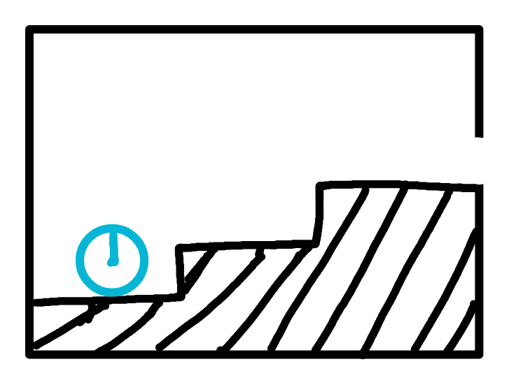

# R1：起始房

> 状态：布局已确认，等待灰盒制作。

## 房间职责

- 新游戏出生房和默认复活房。
- 蓝色时钟装置是主角初始点，对应 `CP_R1_Start`。
- 当前默认作为安全教学空间，不配置普通敌人或伤害机关。

## 布局与连接

- 主角从左下方时钟装置附近出生。
- 地面从左向右逐级抬高，右侧高台的开放缺口连接 R2。
- 进入 R2 后，玩家从 R2 左上角台阶上方的缺口出现。
- 入口和出口均为真实墙体缺口，不使用传送门或交互按键。

## 镜头

- 不采用一屏显示完整房间的固定镜头。
- 保持草图结构并横向扩展，灰盒目标约为 2～2.5 个镜头宽度。
- 镜头在房间边界内跟随玩家；出生时只能看到时钟与附近地形，R2 出口随探索逐渐进入画面。

## 灰盒验收

- 出生点、默认复活点和时钟装置位置一致。
- 玩家能沿台阶自然抵达 R2，且出生时不能直接看到出口。
- 镜头不越过 R1 边界，也不展示 R2 未加载区域。
