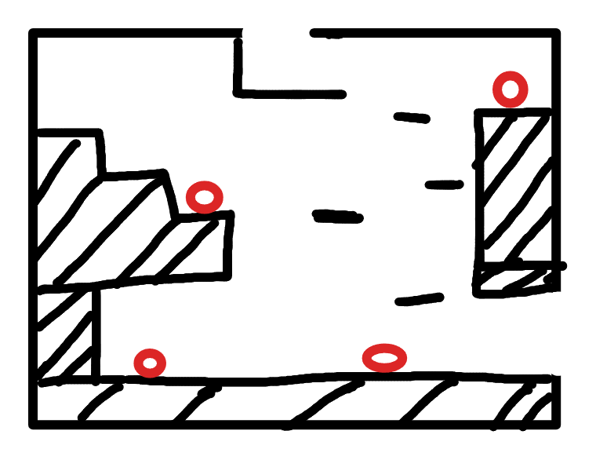

# R2：初始分流房

> 状态：布局已确认，等待灰盒制作。

## 连接

- 左上角台阶上方的缺口连接 R1，并与 R1 右侧高台出口对齐。
- 顶部缺口连接 R3。
- 右侧缺口连接 R4 的机关门外前室。

## 地形与敌人

- 阴影区域全部是实体墙体或地面，黑色横线是可站立平台。
- 房间按较大的纵向战斗空间制作，镜头跟随玩家移动，不直接展示顶部 R3 出口。
- 配置 4 只基础地面怪：左侧中层台阶、左下地面、中下地面和右上高台各 1 只。
- 进出 R2、死亡或检查点刷新时重置普通敌人。

## 路线

- 玩家从 R1 进入时位于左侧较高位置，可以先观察房间局部，再向下进入主体区域。
- 玩家通过平台向上抵达 R3；上下切房保留跳跃动量和进入方向。
- 玩家可以进入 R4 门外前室，但在 R4 侧捷径门开启前不能进入 R4 主体。

## 灰盒验收

- R1、R3、R4 三个入口高度与相邻房间严格对齐。
- 四只敌人的活动范围不会跨越房间出口或从平台意外坠落后软锁。
- 从底层存在清晰可读的回程路线，可以重新抵达 R1 和 R3 入口。
