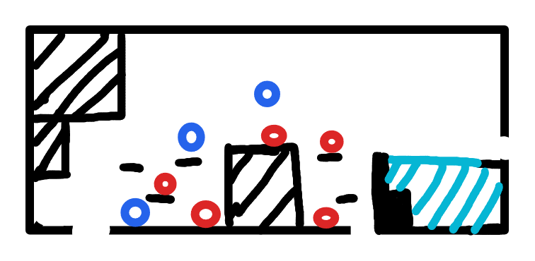

# R3：深水能力门房

> 状态：布局与水池规则已确认，等待灰盒制作。

## 连接

- 左下角缺口连接 R2。玩家从下方跳入 R3 时保留向上动量，并根据进入瞬间的朝向或水平输入决定跳出方向。
- 右下角缺口连接 R4，前期可以正常通过。
- 右侧缺口连接 R6，但初次到达时被深水池跨度阻断。

## 地形与敌人

- 阴影区域是实体墙体，黑色短线是可站立平台。
- 配置 5 只基础地面怪和 3 只飞行接触怪。
- 飞行怪通过接触造成伤害，受到时缓和时停影响。

## 水池规则

- 正常状态下玩家可以进入水中，不扣血，也不传送回岸边。
- 水下采用重力式活动：玩家可以在池底移动和跳跃，不使用自由方向游泳。
- 水池足够深，玩家不能从池底直接跳上右岸；池底左侧设置小台阶，使玩家可以逐段跳回左岸，避免软锁。
- 从左岸起跳并接 Dash 仍无法到达右岸，必须取得时停能力后回来解锁路线。
- 时缓不会冻结水面。
- 时停期间水面形成可站立的凝固层，水外玩家可以沿水面前往右岸和 R6。
- 玩家身体中心低于水面时发动时停，会被冻结在水下，不能移动、跳跃、Dash、攻击或再次使用动作能力；时停计时仍继续。
- 时停结束后恢复水下控制，玩家速度归零，不继承冻结前的下落速度。
- 冻结实现使用水面平台碰撞与水下玩家锁定状态，不用覆盖整个水池的实体碰撞体挤出玩家。

## 灰盒验收

- 未获得时停时无法通过跳跃或 Dash 抵达右岸，但始终可以从池底返回左岸。
- 水外时停可以安全走过凝固水面；水下时停会可靠锁住玩家并在结束后释放。
- 时停结束后站在水面上的玩家自然落入水中，不发生卡墙或连续伤害。
