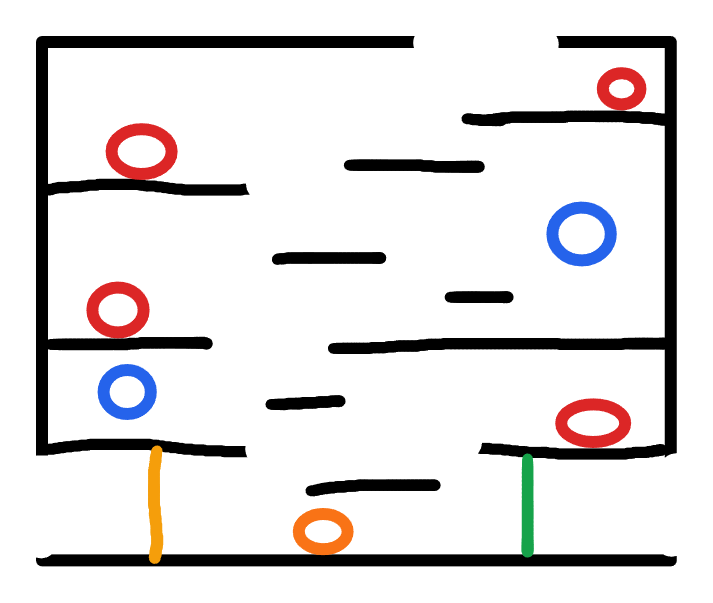

# R4：捷径与时缓机关房

> 状态：布局与机关规则已确认，等待灰盒制作。

## 连接

- 左下角缺口连接 R2 的门外前室。
- 顶部缺口连接 R3；玩家首次从 R3 向下进入 R4 主区域。
- 右下侧缺口连接 R5。

## 捷径机关门

- 草图中的黄色竖线是封锁 R2 前室与 R4 主区域的机关门。
- 开关位于机关门右侧，只能从 R4 主区域接近并按 `W` 开启。
- 机关门不能从 R2 一侧开启或强行破坏。
- 开启后本次运行永久保持，死亡、换房和敌人刷新不会关闭；重新加载场景后重置。

## 高速旋转机关

- 草图中的绿色竖线表示封锁 R5 路线的高速旋转机关，最终造型保持原创，只参考同类机关的功能可读性。
- 正常速度下不能靠普通跳跃或 Dash 强行通过，接触造成 1 点伤害并击退到安全侧。
- 时缓期间旋转速度随世界倍率降低，形成明确的安全通过窗口。
- 时停期间完全停止；首次经过时玩家尚未取得时停能力，因此标准解法是使用时缓。

## 敌人

- 4 只基础地面怪。
- 2 只飞行接触怪。
- 1 只远程怪，发射蓝色可被横砍、上砍或下劈击落的弹幕。
- 进出 R4、死亡或检查点刷新时重置普通敌人，不重置已经开启的机关门。

## 灰盒验收

- 首次从 R2 进入只能到达机关门左侧；从 R3 进入后能够到达开关右侧。
- 开门后 R2 与 R4 可以双向通行。
- 正常状态无法穿过旋转机关，时缓状态存在稳定且可读的通行窗口。
- 从 R3 到开关、从开关到旋转机关、从旋转机关到 R5 的路线均不存在非预期软锁。
