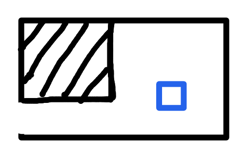

# R5：时停能力获取房

## 当前状态

- 草图布局已确认，等待后续灰盒制作。
- R5 是从 R4 进入的尽头能力房，取得能力后原路返回 R4。
- 本页只记录关卡功能和草图含义；蓝色方块对应道具的最终造型留到 V2 美术阶段确定。

## 布局与连接

- 左侧下方的开放缺口连接 R4，是本房间唯一入口和出口。
- 黑色阴影区域是实体墙壁；左上方形成向房间内部伸出的实体墙体／顶棚。
- 房间整体较紧凑。镜头仍按项目通用规则在边界内跟随玩家，不为展示全貌而强制缩小。
- 草图未标注平台、敌人或伤害机关，因此当前按安全的能力获取房记录；后续除非另有草图或明确说明，不主动增加战斗遭遇。

## 时停能力道具

- 蓝色方块是时停能力道具的临时位置标记，不代表最终尺寸、轮廓或美术造型。
- 玩家直接触碰道具后获得能力，不需要按 `W` 交互。
- 玩家取得后解锁按 `I` 即时开关的时停能力；时停以 10 点/秒持续消耗时间槽，满槽最多维持 10 秒，V2 不设置时长升级。
- 能力在本次运行中保留，不因死亡、坐检查点、换房或普通敌人刷新而撤销；重新加载场景后重置。
- 取得能力后，玩家返回 R4，再经 R3 使用时停冻结水面，前往 R6。

## 已确认数值

- 首次取得时立即把时间槽补满至 100 点，保证玩家可以马上试用完整时停。
- 道具的名称、外观、拾取动画和提示表现，等待美术阶段说明。

## 灰盒验收

- 玩家只能从左侧真实缺口进出，不能从房间边界或左上实体墙绕行。
- 进入房间后可以清楚发现并安全抵达能力道具。
- 取得能力后返回 R4 的路线保持畅通，不产生软锁。
- 死亡或换房后，已经取得的时停能力不会在当前运行中丢失，道具也不会重复授予能力。
