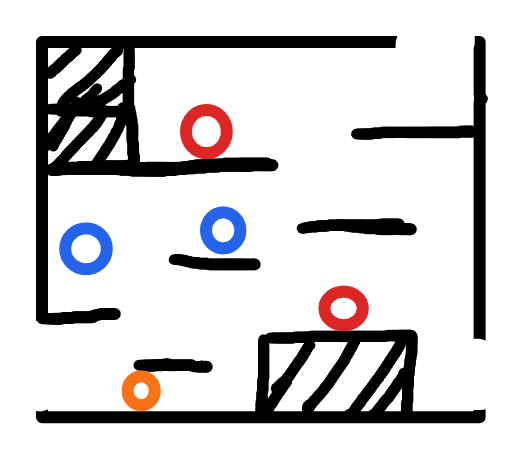

# R6：后期枢纽战斗房

> 状态：布局、入口与敌人类型已确认，等待灰盒制作。

## 连接

- 左下角开放缺口连接 R3，是玩家冻结水面后首次进入 R6 的入口。
- 右上方开放缺口连接 R7 的右下入口，通往 Boss 前存档点支路。
- 右下角开放缺口连接 R8，是 Boss 房入口。
- 三个入口均为墙体真实缺口，玩家穿过边界后换房，不显示传送门，也不要求按键。

## 地形

- 黑色阴影区域为实心墙体或地面。
- 黑色短线为可站立平台。
- 左上有实体墙体形成的高台区域；房间下方中央偏右有实体台座。
- 平台和实体墙体位置以原始草图为准；灰盒制作时只做碰撞可读性微调，不擅自增加捷径。
- 镜头在房间边界内跟随玩家移动，不为了展示整个房间而强制缩小。

## 敌人

- 2 只基础地面怪：一只位于左上高台，一只位于下方中央实体台座顶部。
- 2 只飞行接触怪：分布于房间左侧与中部空域。
- 1 只远程怪：位于左下地面，发射可被玩家攻击击落的弹幕。
- 进出 R6、死亡或检查点刷新时重置这些普通敌人；R7 存档点、已获得能力和 Boss 胜利状态不随敌人刷新撤销。

## 灰盒验收

- 从 R3 进入后，玩家能够通过平台路线抵达 R7 与 R8 两个出口。
- 各平台间距必须适配当前跳跃、空中移动和 Dash，不要求使用未拥有的新能力。
- 敌人分布不能在任一入口生成即命中，也不能把玩家持续封死在狭窄落点。
- R7 支路与 R8 Boss 路线在空间和镜头上易于区分。
