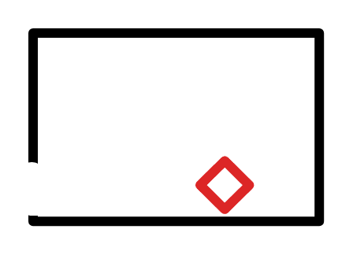

# R8：Boss 战房间

> 状态：布局、入口、Boss 占位和场地锁规则已确认，等待灰盒制作。

## 连接与地形

- 左下角开放缺口连接 R6 的右下出口，是本房间唯一入口和出口。
- 黑色轮廓内为 Boss 战场；底部为连续实体地面，草图未标注额外平台。
- 红色菱形表示 Boss 单位的临时位置和占位符，不代表最终外观、碰撞形状或美术比例。

## Boss 场地锁

- 玩家进入并正式触发 Boss 战后，左下开放缺口由突然出现的实体机关墙封锁。
- 场地锁必须有清楚的出现反馈，并使用实体碰撞阻止玩家离开；不能只显示提示文字或透明空气墙。
- Boss 被确认击败后，机关墙自动打开，并在本次运行中保持开放。
- 玩家死亡时结束并重置未完成的 Boss 战，清除弹幕、恢复 Boss 第一阶段和满血；复活期间解除场地锁，玩家重新进入并触发战斗时再次关闭。
- 已确认击败的 Boss 不会因换房、普通敌人刷新或检查点休息而复活。

## 灰盒验收

- 玩家从 R6 进入时不会在越过边界的同一帧遭受不可规避伤害。
- 战斗开始后无法从左下缺口离开，也不能通过 Dash、受击击退或碰撞缝隙穿过机关墙。
- Boss 死亡后出口立即恢复可通行，玩家能够返回 R6。
- 玩家死亡后的场地锁、Boss 阶段、生命、弹幕和临时时间状态均按重试规则重置。
