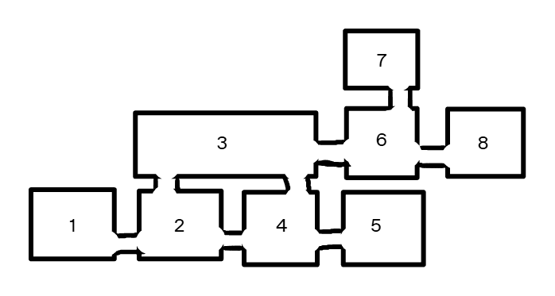

# V2 八房间总地图总览

> 状态：总拓扑已确认。总览图只决定房间连接关系和主流程，实际墙体、平台、入口高度、敌人与机关位置以 R1～R8 逐房间草图和对应文档为准。

## 固定连接

- `R1 ↔ R2`
- `R2 ↔ R3`
- `R2 ↔ R4`：R2 侧先被机关门阻断，须从 R4 侧开启捷径。
- `R3 ↔ R4`
- `R3 ↔ R6`：深水池能力门，须取得时停并冻结水面后通过。
- `R4 ↔ R5`：高速旋转机关，首次标准解法是时缓。
- `R6 ↔ R7`：Boss 前存档点支路。
- `R6 ↔ R8`：Boss 房路线。

不存在 `R5 ↔ R6` 或其他未列出的连接。

## 主流程

1. 玩家在 R1 的 0 时刻存档点出生，经开放缺口进入 R2。
2. R2 分流至 R3 与 R4 门外前室；R2 侧不能越过捷径机关门。
3. 玩家经 R3 进入 R4 主体，从机关门另一侧按 `W` 打开 R2↔R4 捷径。
4. 玩家在 R4 使用时缓通过高速旋转机关，进入 R5。
5. 玩家在 R5 触碰道具取得时停并补满 100 点时间槽，随后原路返回。
6. 玩家回到 R3，用时停冻结深水池水面并进入 R6。
7. 玩家可先从 R6 前往 R7，激活指向 1 时刻的 Boss 前存档点。
8. 玩家从 R6 进入 R8，触发场地锁并挑战 Boss。

## 使用规则

- 总览图不作为 Unity 灰盒的比例尺，也不直接决定摄像机边界。
- 若总览轮廓与逐房间草图细节不一致，以对应房间草图和房间文档为准；但连接关系不得擅自改变。
- 普通入口均为墙体真实缺口，玩家穿越边界后换房，不使用传送门表现。
- 当前 V2 测试版不写磁盘存档；文档中的“存档点”表示本次运行的复活点与休息点。
